  

  
  
  
  

Second-year B.Tech CSE (Cybersecurity) student at DBS Global University, Dehradun. I work on hardware security and digital forensics. Where I want to end up is investigative forensics at an international level.

My portfolio is a forensics lab. A UV lamp follows your cursor and reveals hidden evidence, an evidence board joins my projects with red string, and there is a simulated power-analysis attack you can run with a slider for the number of traces. I am starting to write field notes there too. Go and look: **[raavi29.github.io](https://raavi29.github.io)**

## Chain of custody

## Research

**TROPIC01 secure element analysis.** An independent analysis of Tropic Square's development kit at the de.ci.phe.red Lab, IIT Bhilai, under Dr. Dhiman Saha. I read the USB descriptors, tested the SPI protocol against its conformance spec, decompiled the STM32 firmware in Ghidra, and checked that Mac-and-Destroy key destruction holds across 11 sequential PIN attempts. It produced 62 confirmed findings and a conformance test suite. Power analysis with a ChipWhisperer Husky has started. The code is lab-restricted, so there is no public repository.

**Towards Intelligent Ransomware Defence.** A systematic review of machine learning and deep learning ransomware detection across four years of literature, with Prof. Merry KP. Accepted and presented at IJCACI 2026 in July, and validated in FlareVM and REMnux. It found a gap between detection accuracy and forensic recoverability.

**RansomGuard.** A solo project that closes that gap. It detects ransomware behaviour and collects forensic evidence at the moment it fires: affected files, process tree, network state and a timestamped evidence chain. Architecture phase. Python, watchdog, psutil, scikit-learn, SQLite, Streamlit.

**TrusToken and Rowhammer.** Attack and analysis work on a cryptographic USB token built by C-DAC Noida and IIT Bhilai, and a Rowhammer attack in a simulated environment. Both stay private.

## Open source

- **OWASP Nettacker.** One merged pull request. I researched CVE-2025-32756, an existing critical remote code execution flaw in Fortinet FortiVoice, to improve the scanner's detection modules. I applied to GSoC 2026, was not selected, and kept contributing.
- **VLED Lab, IIT Ropar.** Open Source Intern under Prof. Sudarshan Iyengar, with commits on a live public repository. It runs to the end of December 2026.
- **GirlScript Summer of Code.** Contributor.

## Competitions

| Project | Result | My part |
|---|---|---|
| Saheli, a WhatsApp-first labour marketplace for homebound women | CII Yi Yuva National Grand Finale 2026 | Team lead |
| GreenLight, traffic optimisation tested in SUMO | Smart India Hackathon 2025 national finalist, IIIT Dharwad | Primary presenter |
| One True Friend, an inclusive workforce intelligence platform | SAP Hackfest North Region 2026, finale round | Team lead |

## Toolbench

Hardware: ChipWhisperer Husky, PhyWhisperer USB, SPI analysis, USB forensics. Reverse engineering: Ghidra. Forensics and malware: FlareVM and REMnux in a host-only home lab, Nmap. Web: React and Node.js.

I am looking for a research placement in summer 2027 and for collaborations in hardware security and digital forensics.

